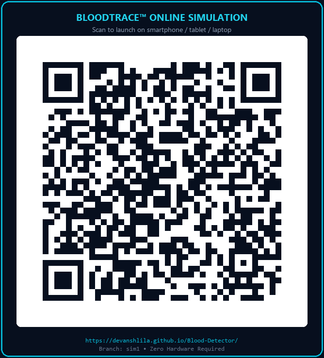

# BloodTrace — Dual-Wavelength Medical Instrument Contamination Detection Simulator

[](#)
[](#)
[](#)
[](#)

> **IMPORTANT SCIENTIFIC NOTICE & REGULATORY DISCLAIMER:**
> **SIMULATED DATA — NOT A CLINICAL TEST RESULT.**
> BloodTrace is a college-level biomedical and optical engineering simulation of an optical screening prototype designed to visualize suspected residue on reusable surgical instruments before autoclaving.
> All detected regions are strictly categorized as **"Suspected Residue"** or **"Possible Contamination"**, never as confirmed blood. Optical screening provides rapid pre-screening localization but does not replace validated chemical protein assays (e.g. BCA or ninhydrin swabs) or biological spore indicators.

---

## 🌐 Live Online Simulation & Instant Mobile Access

Experience the interactive **BloodTrace™ Vision** simulation directly in your web browser — no external hardware or local installation required:

👉 **Direct Web Link**: [**https://devanshlila.github.io/Blood-Detector/**](https://devanshlila.github.io/Blood-Detector/)

### 📱 Scan QR Code to Launch on Mobile / Tablet / Laptop
Judges, professors, and reviewers can scan the QR code below using any smartphone camera to open and test the simulation live:

<p align="center">
  <a href="https://devanshlila.github.io/Blood-Detector/">
    
  </a>
  <br />
  <em><strong>Scan to Open BloodTrace™ Vision</strong> | Hosted on GitHub Pages (Branch: <code>sim1</code>)</em>
</p>

---

## 1. Project Overview & Physical Principles

In hospital Sterile Processing Departments (SPD) and Central Sterile Services Departments (CSSD), reusable surgical instruments (forceps, dissecting scissors, hemostatic clamps) must be meticulously cleaned to remove organic bioburden (dried blood, tissue proteins, coagulum) before packaging and terminal sterilization.

**BloodTrace** combines dual-wavelength optical excitation with computer vision to inspect instruments non-destructively:

1. **365 nm UV-A LED (Pin D9):**
   - Organic cellular proteins and free porphyrins exhibit weak autofluorescence.
   - Crucially, residual cleaning detergents containing optical brighteners and surfactants fluoresce intensely in the cyan-blue band (~430–470 nm).
   - This makes UV-A alone prone to false positives from detergent films.
2. **850 nm Near-Infrared (NIR) LED (Pin D10):**
   - Clean electropolished stainless steel (AISI 316L / 420) exhibits ~60–70% specular reflectance in the near-infrared.
   - Dried hemoglobin and methemoglobin exhibit high diffuse optical density and strong absorption at 850 nm.
   - Dried blood spots appear as stark dark silhouettes against reflective steel, while detergent residues remain virtually transparent.
3. **BPW34 PIN Photodiode (Pin A0):**
   - High-speed silicon PIN photodiode paired with a transimpedance amplifier (MCP6002).
   - Converts optical radiation into voltage fed into Arduino UNO R4 Minima 10-bit ADC (A0).
4. **Laptop Analysis Dashboard:**
   - Simulates a Python/OpenCV computer vision pipeline: background subtraction, Normalized Difference Index (NDI), bilateral noise filtering, and contour extraction.

---

## 2. Hardware Architecture & Schematic

- **Microcontroller:** Arduino UNO R4 Minima (Renesas RA4M1 32-bit ARM Cortex-M4 @ 48 MHz)
- **Pin D9:** Controls UV LED MOSFET gate (IRLZ44N) through a 1 kΩ current-limiting resistor.
- **Pin D10:** Controls dual 850 nm IR LED MOSFET gate (IRLZ44N) through a 1 kΩ resistor.
- **Pin A0:** Reads BPW34 photodiode transimpedance amplifier analog output (0–1023 ADC counts).
- **Pin D2:** Tactile push-button with internal `INPUT_PULLUP` to ground to trigger scans.
- **USB-C:** High-speed virtual COM port streaming serial telemetry at 115200 baud.

---

## 3. Application Structure

The application features a responsive, dark navy scientific workstation interface:
- **Device Simulation View:**
  - Matte-black light-tight optical chamber with access door.
  - Front-facing camera and UV/NIR optical ray projections.
  - Interactive Arduino UNO R4 Minima visual board with live LED matrix and pin status indicators.
  - Interactive circuit interface schematic.
  - Virtual 115200 baud serial monitor with command prompt (`SCAN`, `MODE=1`, `CALIB`, `STATUS`).
- **Laptop Analysis Dashboard View (BloodTrace Vision):**
  - **4-Panel Synchronized Optical Inspection Workstation (Matches Poster Design):**
    - **Panel 1: Visible Image** — Actual photographic specimen or clean reference surface.
    - **Panel 2: UV Image (Simulated 365 nm)** — Luminous autofluorescence visualization.
    - **Panel 3: IR Image (Simulated 850 nm)** — Grayscale near-infrared reflectance with hemoglobin absorption.
    - **Panel 4: Contamination & Surface Analysis Map** — Pixel-aligned candidate residue overlay with vertical High-Low gradient color bar.
  - **Bottom Status Indicator:** Displays dynamic `Total Contaminated Area: X.X%` with glowing `[CONTAMINATION DETECTED]` or `[NO CANDIDATE REGION DETECTED]`.
  - **Dedicated "Compare Both" View:** Side-by-side comparison of clean reference vs. blood-contaminated challenge with difference visualization and differential parameters table.
  - **Candidate Region Inspector:** Interactive cards reporting Region ID (ROI-01, etc.), confidence score, area, UV/IR scores, and optical explanation.
  - **Real-Time Controls:** Detection threshold slider, min region size, UV/IR intensities, overlay opacity, and UV mode selector.
  - **Real Photographic Test Specimens:**
    - Clean Reference Surface (`assets/images/clean_surface.jpg`)
    - Blood-Contaminated Surgical Clamp (`assets/images/contaminated_surface.jpg`)
    - Contaminated Scalpel Blade (`assets/images/scalpel_blade.jpg` — matches poster reference)
    - Surgical Tools Set with Blood Marks (`assets/images/surgical_set_blood.jpg`)
    - Contaminated Gauze (`assets/images/contaminated_gauze.jpg`)
- **Results & Records View:**
  - Historical table of all screening runs with telemetry data.
  - One-click inspection of previous scan profiles.
- **Engineering Specs View:**
  - Optical physics equations, hardware BOM (~$64 total), CV pipeline graph, and clinical scope.
- **Built-in Demonstration Scenario ("Run Demo"):**
  - 9-step guided interactive walkthrough for academic and professor presentation.
- **Export Capabilities:**
  - Downloadable CSV data file.
  - Formal printable engineering report modal with image snapshots and sign-off blocks.

---

## 4. How to Run

### Quick Launch
Double-click `start.bat` or run:
```bash
python -m http.server 8000
```
Then navigate to `http://localhost:8000` in any modern web browser.

---

## 5. Verification & Testing

To run the automated Python DOM & Component Binding Tests:
```bash
python test/test-dom.py
python test/test-component-bindings.py
```

To run the Real Image Mathematical Verification Tests:
```bash
python test/test-real-image-processing.py
```

To run the full Browser-based Simulation Test Suite:
Navigate to `http://localhost:8000/test/runner.html` in your browser. All tests pass with 100% assertions satisfied.
